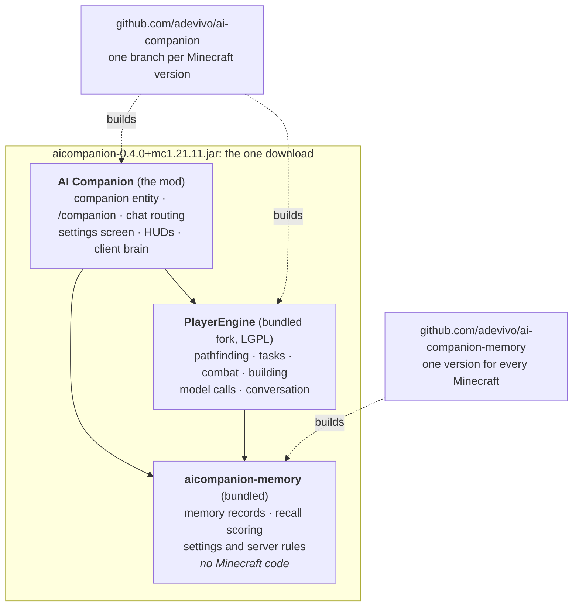

# ai-companion-memory

The AI Companion's memory engine: a bitemporal record schema, deterministic contradiction
resolution, and a retrieval scorer — implemented twice, in Java for the Fabric mod and in JS for
the browser chat, pinned to a shared fixture so the two cannot drift apart.

Graduated from `../ai-companion-memory-poc` on 2026-08-13, after every open question it existed to
answer had been measured against a corpus of real conversation and ~2,400 human labels.

```
engine/    Java 17, Gson only. Drops into the mod unchanged.
           …/memory/  the memory engine: records, contradiction resolution, retrieval scoring
           …/core/    config schemas, server policy, roster ownership, the brain turn contract
js/        The browser half. Zero dependencies.
fixture/   28 synthetic records, 21 cases. Both implementations must reproduce it exactly.
```

## Its role: the version-neutral core

This repository is the part of AI Companion that **does not know Minecraft exists**, and that is its
entire value. It has zero `net.minecraft`, `net.fabricmc` or `org.quiltmc` imports, builds as a plain
Java 17 + Gson project with no Loom and no mappings, and ships into the mod as a jar-in-jar,
pinned to an exact version.

That property is what makes supporting several Minecraft versions affordable.

Where it sits in the download (the mod lives at
[github.com/adevivo/ai-companion](https://github.com/adevivo/ai-companion)):



### The problem it solves

`ai-companion-mod` targets multiple Minecraft versions, one branch per version (`mc/1.20.1`,
`mc/1.21.11`, …). Its `engine/` — our fork of PlayerEngine — is re-based per version on upstream's own
per-version branch, and upstream renamed every package between the versions we forked
(`baritone.*` and `adris.altoclef.*` became `com.player2.playerengine.*`) and moved to Architectury.

The consequence, measured 2026-08-22: **the engine trees on two branches share no source file paths
at all.** 733 paths on one, 676 on the other, 12 in common, all 12 build scaffolding. A cherry-picked
engine fix does not conflict — git finds no file to apply it to.

And that is where the work happens. Of the last 40 commits on the mod's main line, 8 touched only the
engine and 22 touched both; just 3 were mod-only. So without somewhere version-neutral to put things,
roughly nine fixes in ten would have to be written twice, by hand, forever — and the tests with them.

### The division of labour

| Belongs **here** | Belongs in the mod's `engine/` |
|---|---|
| Memory: records, contradiction resolution, retrieval scoring | Pathfinding, tasks, chains |
| Extraction, gating, health checks | Mixins and everything version-coupled |
| Config schemas (LLM, memory, TTS, behaviour, embeddings) | Block and entity interaction |
| Server policy, roster ownership, player preferences | Structure building |
| The brain contract (transport interface, turn context) | The Minecraft-side brain plumbing |
| **The tests for all of the above** | |

The rule of thumb, for anyone adding a file to the mod's `engine/`: **if it does not need Minecraft,
it does not belong there.** Putting version-neutral logic in the engine signs you up to port it to
every Minecraft version, forever.

### How the mod consumes it

Built here, staged into `aicompanion/libs/`, nested into the shipped jar (JiJ) and depended on by an
**exact** version — never `+`. Gradle caches dynamic-version resolution, so restaging a rebuilt jar
under an unchanged version silently keeps the old one; that has cost real debugging time more than
once. Gson is deliberately *not* nested alongside it: Minecraft already ships Gson, and a second copy
on the classpath is a hazard rather than a redundancy.

The workflow for a fix that lives here:

1. Fix it once, here, on `main`. There are no version branches in this repository and there should
   never be one — a per-Minecraft-version branch of version-neutral code is a contradiction, and an
   invitation for someone to make one copy quietly version-specific.
2. Cut a release and bump `version` in `engine/build.gradle`.
3. Bump the pin in `aicompanion/build.gradle` on each live `mc/*` branch. That file **is** a shared
   path across those branches, so the bump is a genuine one-line cherry-pick.

### Planned expansion, and the name

**Landed 2026-08-22 (0.5.0).** The first hoist out of the engine: 12 source files and 4 test classes,
3,283 lines, now in `com.neovetta.aicompanion.core` — `LlmConfig`, `MemoryConfig`, `TtsConfig`,
`BehaviorConfig`, `EmbeddingsConfig`, `ServerPolicy`, `RosterGuard`, `PlayerPreferences`,
`MemoryGate`, `MemoryHealth`, `BrainTurnContext`, `CompanionTickGuard`. Test count went 115 → 201,
and those 86 tests now run once rather than once per Minecraft version.

That is fewer files than first estimated, and the estimate was wrong in an instructive way. Scanning
for `net.minecraft` imports suggested 29 files were free-standing. Two kinds of coupling do not show
up as imports: **same-package references need none at all**, and several files leaned on small engine
utilities (`HTTPUtils`, `Utils`, `DirUtil`). A reference scan with comments and string literals
stripped — Javadoc `{@link}` alone produced nine false positives — gave the real answer.

Still in the engine, deliberately:

- `MemoryExtractor`, `MemoryStore`, `EmbeddingsService` — version-neutral in substance but each leans
  on one small engine utility. They can follow once those are replaced or inlined; that is a contained
  piece of work, not a redesign.
- `MemoryLearner` — genuine glue. It wires `CompanionMemory` to `ConversationHistory` and
  `Player2APIService`, so it belongs on the Minecraft side.
- `ConversationHistoryNullContentTest` and `BrainFailureAdviceTest` — same-package tests of engine
  classes, so they stay with their targets.

⚠️ **The 1.20.1 line still carries its own inline copy of these 12 files.** Until it is migrated to
depend on 0.5.0, the same logic exists in two places and can drift — exactly what this repository
exists to prevent. That migration is deliberately sequenced *after* the 1.21.11 port proves the
layering works, so the shipping line is not disturbed on an unvalidated design.

Once that lands the name `ai-companion-memory` is wrong — it will hold policy, configuration and the
brain contract as well as memory. A rename to something like `ai-companion-core` is agreed in
principle and deliberately deferred: renaming the repository, directory and artifact id in the middle
of a Minecraft port would be two hard changes at once. Do it at a quiet moment, not during.

## Run it

```bash
cd engine && ./gradlew test     # 201 tests
cd js      && npm test          # 22 tests, no install needed
```

## What is settled, and what it cost to learn

Everything here was measured. The numbers live in the POC's `docs/`; the short version:

**Scoring is relevance only.** Park et al.'s `recency + importance + relevance`, min-max normalised
and summed, is implemented and reproducible (`MemoryScorer.park()`) — and it **loses to plain
cosine**. On 295 natural questions it gave up seven points of recall@10 (86.1% → 79.3%) and
two-thirds of rank-1 accuracy (61% → 15%). No weighting of the other three terms beat relevance
alone; the best any of them managed was to get out of the way at a 10:1 relevance weight.

The mechanism is min-max normalisation making weak terms commensurate with strong ones. It
guarantees *some* candidate scores 1.0 on every term regardless of how little real spread exists,
so two weak terms can outvote an exact semantic match.

**The terms are kept at weight zero rather than deleted.** They cost nothing unweighted, one flag
re-enables any of them, and there is one case they might still win that no eval here could reward:
choosing among several genuinely relevant memories. Every measurement used a single gold record,
which structurally cannot credit promoting a different-but-better memory.

**Nothing decays.** Owner labelling found zero stale facts in 64 spanning 30 to 270+ days, bounding
staleness under ~4.7% where Park's constant predicts effectively total decay past a fortnight.
`DEFAULT_HALF_LIFE_HOURS` is 91 days and inert at weight zero — it is not a decay rate but the point
where the term stops damaging the ranking, kept so that enabling recency for an experiment does not
silently drag Park's 5.8-day constant along with it.

⚠️ That bound is mostly a statement about **traits**. 70% of the labelled sample was trait-like
predicates, which cannot go stale; state-like facts were 0 stale of 16, an upper bound of 19%.

**`importance` carries no information.** Four independent measurements agree: no separation at turn
level, none at fact level, none within owner truth labels, and in retrieval its entire measurable
effect is preferring an extracted fact over a raw conversation turn — a *kind* preference, which is
what it should be expressed as.

**Frame is a filter, enforced before ranking.** `IN_WORLD` memories are reachable only when their
companion is asking. Measured: ordinary-chat facts about the player are 95% true, the same claims
made inside fiction are 76% true when the player said them and 43% when the model did. There is no
weight that makes a 43%-true class acceptable to merely rank low, so it is excluded outright.

**k = 5–10.** MRR is flat past k=5 and token cost grows linearly. Under a bring-your-own-key model
tokens are customer-visible money, so a recall win that inflates context is a regression.

**int8 scan, float32 rescore, candidate multiplier 2.** Quantisation costs 4.8% of the exact
ranking; one rescore pass over 2k candidates recovers 100.00% of it.

## The cross-language contract

The two implementations must return identical rankings. If they do not, the same companion tells
the player different things depending on whether they are in the game or the browser — a failure
with no natural symptom, which nothing in normal use would surface.

Held by four mechanisms, all in the code:

- Scores are compared **rounded to six decimals**, so a last-bit `exp()` difference between
  `StrictMath` and a JS engine cannot swap two memories.
- The tie-break chain is **total**: score, then higher serial, then id. Nothing is left to a sort's
  discretion.
- Float32 components are accumulated in **double** on both sides, in the same iteration order.
- Float-width fields are rounded to float32 on the JS side. `MemoryRecord.importance` is a `float`
  in Java and a double in JS; min-max amplifies that 1.2e-8 gap by `1/(hi−lo)`, and below a spread
  of ~0.02 it exceeds what the ranking comparison can see. This was found by running both engines
  over 9,052 real records, not by the fixture.

`fixture/` verifies **logic** parity — ordering, filtering, tie-breaks. It provably does not verify
**precision** parity: at 8 dimensions the six-decimal comparison absorbs every rounding difference.
That check lives in the POC (`js/tools/agree.js`) because it needs the real corpus, and it reports
bit-identical agreement across 2,950 slots.

Regenerate the fixture with `cd engine && ./gradlew -q fixture`. This moves the goalposts for both
implementations at once, so it is a deliberate act and never a way to make a red test green — run
both suites afterwards, and the POC's real-corpus check before shipping.

## What is deliberately not here

Four things must be rebuilt for production rather than ported, and the POC's versions would be
wrong here:

- **User identity.** The POC resolves the owner from a `.env` alias. The mod must resolve per-player
  from the authenticated profile at call time.
- **Fiction detection.** The genre classifier generalises; the named-cast heuristic does not. In the
  mod every conversation has a named companion, so the cast rule would flag everything.
- **Entity clustering.** POC cluster ids are positional and order-dependent. Production must persist
  centroids and mint durable ids — **centroids become stored memory state, not a derived artifact.**
- **Occurrence counting.** The POC folds a static corpus in batch. The mod increments one fact at a
  time: look up entity → compare value → confirm or supersede.

No stubs were written for these. Everything in this repository was measured, and inventing an
unvalidated interface would break the property that makes it worth trusting.

## Licence

LGPL-3.0-or-later, matching `ai-companion-mod`. See [LICENSE](LICENSE); the LGPL builds on the GNU GPL v3,
whose text is in [LICENSE.GPL-3.0.txt](LICENSE.GPL-3.0.txt).
